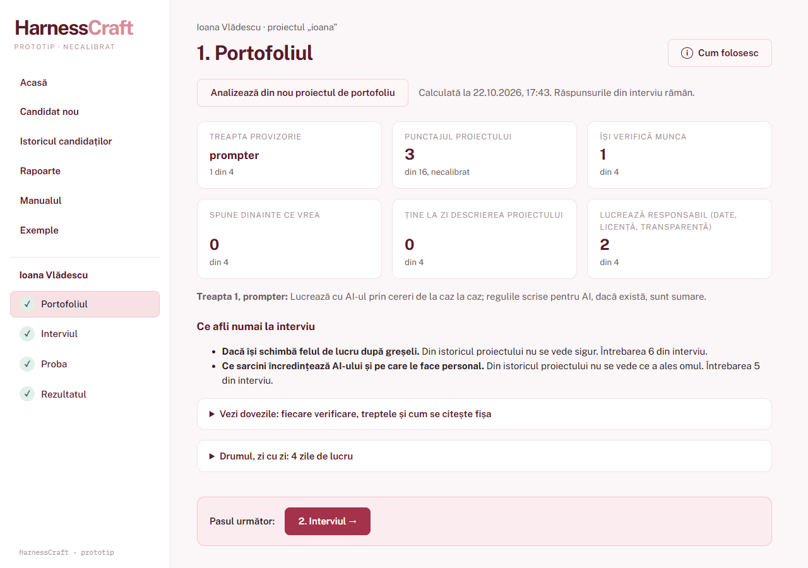

# HarnessCraft — assessing how a candidate works with AI

[](https://github.com/Mihai-Streanga/HarnessCraft-public/actions/workflows/tests.yml)

HarnessCraft helps a recruiter find out how a candidate works with artificial intelligence. It takes the candidate
through four steps (their portfolio project, a structured interview, a practical test and the result) and ends with
a report for the hiring file: a total out of 100, in three equal parts, and everything that produced it.

It is a **demonstration prototype, not calibrated**: it shows how the three parts work together. Its thresholds and
weights were chosen and written into the code in advance; validating them on real candidates belongs to a later,
calibrated version. It is not meant for real hiring decisions.

It is a project of the [Streanga Method](https://github.com/Mihai-Streanga/streanga-method-for-claude): the first one
started on the method from its first commit, designed in claude.ai and built in Claude Code.

## What this repository holds

The **whole application**: the analysis of a portfolio project, the interview guide and its scoring, the practical
test with its answer key, the total, the reports, the manual and six worked examples. You can install it, analyse a
project of your own, fill in an interview, mark a test and print the report.

What stays private is **how the tool was checked**: the open-source projects it was measured on, the author's blind
ranking of them, the per-project results and the research code that compares them. Those results grade real people
by name. What they showed is summarised, without names, in [docs/RESULTS.md](docs/RESULTS.md).

The interface, the manual and the installation guide are in **Romanian**: the tool is made for Romanian recruiters.

## The problem

Companies want to hire people who know how to work with AI, but have no concrete way to assess it. A portfolio shows
the result, not how it was reached. A questionnaire measures how well someone describes a method, not whether they
use one. A person's method does leave traces in the history of their projects, and HarnessCraft tries to read them.

## How it works

| Step | What the recruiter does | What the program does |
|---|---|---|
| **1. Portfolio** | gives a project: a folder, a git link, or a `.bundle` file for a private repository | reads the project's git history and the files in which the person wrote rules for their AI tool; answers 16 yes/no checks in four areas and places the project on one of four levels; recomputes that for every day of the project's life |
| **2. Interview** | asks seven questions, the same for everyone, and ticks three yes/no lines per question | writes the interview guide, adds up to four unmarked questions about the candidate's own project, by fixed rules: two from what the checks found missing, one on recent growth, one on a commit about the AI rules; averages the marks |
| **3. Practical test** | sends the task, records consent, uploads the answer sheet, ticks the conversation and debrief lines | matches the answer sheet against the key; a test for payroll is included: a monthly payroll statement with planted errors, for a fictitious company |
| **4. Result** | reads it, prints the report | a total out of 100 in three equal parts, recomputed every time the screen opens; a missing part makes it "incomplete", never zero |



**No AI model is called anywhere.** Every level, point and mark is computed by code from written rules; everything a
person judges (the ticks, the decision to test, the conclusion) is judged by the recruiter, and the code only adds it
up. Everything stays on the computer: the server answers only on `127.0.0.1` and calls no outside service; only
adding a project given as a link uses the internet, to clone it.

How the parts fit together: **[docs/ARCHITECTURE.md](docs/ARCHITECTURE.md)**.

## Running it

Windows, Python 3.12 or newer, git and [gitleaks](https://github.com/gitleaks/gitleaks). Step by step, in Romanian:
[docs/INSTALARE.md](docs/INSTALARE.md). In short:

```bat
py -m venv .venv
.venv\Scripts\python -m pip install pytest
.venv\Scripts\python -m pytest -q
Porneste_HarnessCraft.bat
```

The browser opens at `http://127.0.0.1:8765`. Start with **Exemple**: six worked candidates, every step done, read-only.
Five are invented people; the sixth is the author's own self-assessment, on a private project, so on another computer
it is listed as missing.

## License

© 2026 Mihai Streanga. All rights reserved. Source shown for portfolio purposes: you may clone, install and run it to
evaluate it. Any other use (copying, modifying, redistributing, commercial use) needs the author's written permission.

## About the author

Mihai Streanga is an HR and payroll specialist who builds tools that automate HR work with Claude.
[LinkedIn](https://www.linkedin.com/in/mihai-%C5%9Ftreang%C4%83-aa3a2b176/)
