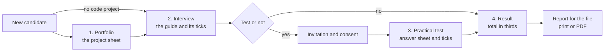
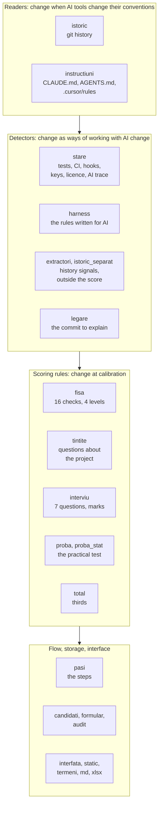

# Architecture

HarnessCraft is a local web application: a Python server on the recruiter's computer, pages in the browser, and one
folder of plain files per candidate. This page shows how its parts fit together and why they are built that way.
What the tool was measured on, and what came out, is in [RESULTS.md](RESULTS.md).

## A candidate's path

| Step | The recruiter | The program | What stays in the candidate's folder |
|---|---|---|---|
| New candidate | names the candidate and gives a project: a folder, a git link or a `.bundle` file | checks it has a history of its own; clones a link | `candidat.json`, `proiect/` for a link |
| 1. Portfolio | presses "Analyse" | computes the project sheet and its path in time; writes the interview guide | `fisa.json`, `ghid.md` |
| 2. Interview | asks, ticks, takes notes, decides on the test | saves on every tick | `ghid.md`, `decizia-probei.json` |
| 3. Practical test | sends the invitation, records consent, uploads the answer sheet, ticks | matches the sheet against the key | `proba.md`, `Raspuns.xlsx` |
| 4. Result | reads, prints the report, closes the application | computes the total when the screen opens | nothing new: the report is made from the files above |

Every step has a state (to do, in progress, done, blocked by the step before it, or "no test", with the reason), shown
on screen and in the candidate list. Every screen has a "How do I use this" panel and ends with the next step.

## Principles

1. **Code computes, people judge.** Levels, points, marks and the total come from rules written in code, with named
   thresholds. The ticks are the recruiter's; their mark is a count.
2. **Two doors to one function.** A button in the interface and a command in the terminal call the same function. The
   interface has no arithmetic of its own: it shows what the calculation modules return.
3. **Files a person can read.** The interview guide and the test sheet are Markdown files; the form on the page reads
   and writes them line by line. A guide filled in by hand is scored exactly like one filled in on the page.
4. **The result is computed every time it is opened**, from the files as they are now. A changed tick shows on the
   next opening, with no "recalculate" button and no result file to go stale.
5. **Fingerprints on everything that is scored.** The guide carries a fingerprint of the questions it was written
   with, the test sheet one of its ticks, the answer key a committed one. Scoring happens only with the texts and the
   key that were actually used.
6. **Everything stays on the computer.** The server answers only on the local address, accepts form posts only from
   its own pages and calls no outside service.
7. **The journal only grows.** Each step appends a line to the candidate's journal, written on the spot; the audit
   report is read from it.
8. **Rules are fixed before measuring.** On the projects used to check the tool, every detector refuses to run until
   the author's blind ranking is committed and complete.

## Where a model judges, and where it does not

| What | A model? | How it is done |
|---|---|---|
| the project's level and points | no | rules in `fisa.py`, on the facts the detectors find |
| the questions about the project | no | 16 questions written in advance, picked in a fixed order |
| the interview mark | no | 1 + the number of "yes" ticks, averaged over the questions asked |
| the test mark | no | the answer key, with its committed fingerprint, and the recruiter's ticks |
| the total | no | three equal thirds, in `total.py` |
| the ticks, the test decision, the conclusion | no: **the recruiter** | in the guide and the test sheet |
| the blind ranking, the verdicts on examples, the question texts | no: **the author** | committed before any run |

Under the EU AI Act, AI systems used to recruit or evaluate candidates are high-risk (Annex III, point 4), and one
of those that profiles people stays high-risk even when it only prepares a decision (Article 6(3)). That is the main reason no model gives a verdict on a project or a person
here. *This is the author's reading, not legal advice.*

## The modules, by what makes them change

| Group | Modules | What they do |
|---|---|---|
| readers | `istoric.py`, `instructiuni.py` | read the git history once, with one parser (merges left out: they record an integration, not authorship), and a guard that counts the commits another way to confirm none were missed; recognise instruction files by each tool's convention, at any depth, and follow each file through renames. A new convention is a new reader |
| detectors | `stare.py`, `harness.py`, `extractori.py`, `istoric_separat.py`, `legare.py` | find facts in the tree at the analysed commit: test files, CI configuration, git and agent hooks, keys (with gitleaks, on the whole history and, separately, on the committed tree), a recognised licence, the AI trace in commits; and, in the instruction files, sections, commands, limits, named files, a pointer to an architecture or decisions document |
| scoring | `fisa.py`, `tintite.py`, `interviu.py`, `proba.py`, `proba_stat.py`, `total.py` | turn the facts into the sheet, pick the project questions, write and score the interview guide, read a test package and match an answer sheet, add up the total |
| flow and storage | `pasi.py`, `candidati.py`, `formular.py`, `audit.py`, `manifest.py`, `gardieni.py` | the steps (the same for the terminal and the buttons), one folder per candidate, the guide as a form, the journal, the git helper, the blind-ranking guard |
| interface | `interfata.py`, `static/`, `termeni.py`, `md.py`, `xlsx.py` | the server and the pages, the manual, the reports; the list of technical terms that may appear on a recruiter's screen only in brackets, after a plain explanation; a small Markdown renderer; an `.xlsx` reader and writer |
| examples | `set_exemple.py`, `capturi.py` | build the worked examples from scratch (the invented candidates' projects as synthetic git repositories) and take the manual's screenshots from them |

## Step 1: the project sheet

The sheet reads the project **at its latest version** and answers **16 yes/no checks**, four in each of four areas.
Each "yes" is a point; the score is out of 16.

| Area (as the recruiter sees it) | The four checks |
|---|---|
| **Checks its own work** | has tests · has automatic checks on a server (CI) · has checks when code is committed (git hooks) · has checks while the AI works (agent hooks) |
| **Says in advance what it wants** | the rules for AI have at least 2 sections · contain the project's commands · say what the AI must not do · has task-specific instructions (skills, commands, subagents, per-folder rules) |
| **Keeps the project's description current** | the rules name at least 3 of the project's files · at most one in five is missing · point to an architecture or decisions document · say how the project is organised |
| **Works responsibly** | no access key in the code now · none in the history · a recognised licence · AI use declared in the history |

Beside the score, the sheet gives a **level**, one of four. The levels are a ladder: a level is reached only with its
own conditions **and** those of every level below it, and the sheet says what is missing for the next one.

| Level | Its conditions |
|---|---|
| 1. prompter | the starting point |
| 2. configurator | rules for AI with at least 2 sections, at least one command and at least one limit |
| 3. system builder | task-specific instructions **and** tests that run on their own (CI, or a hook that runs the tests) |
| 4. methodologist | automatic checks (agent or git hooks) **and** rules kept current (at least 3 files named, at most one in five missing) |

The level says *what kind* of work with AI the project shows; the score says *how well*, with partial credit. Two
principles of the assessment leave no trace in git (whether people change how they work after a mistake, and what
they keep for themselves); the sheet shows them as gaps and sends them to interview questions 6 and 5.

The same analysis runs **on the last version of every day** of the project, so the recruiter sees how it grew, not
only where it ended. On a long history this is the expensive part: keys are scanned once along the whole path, not
once a day, and each version of a file is read once.

## Step 2: the interview

The guide has five parts: an opening read out the same way to everyone; the candidate's background; **seven scored
questions**, the same for everyone and in the same order (why they work with AI, thinking with it in conversation,
building with it in code, checking its work, what they delegate and what they keep, learning from mistakes,
responsibility for data and ethics), each with three yes/no lines; questions that carry no mark; and the close.

**A question's mark is 1 + the number of "yes" ticks**, so between 1 and 4. A question not asked does not count
towards the average; a half-filled one is refused, by name.

The unscored part starts with **up to four questions about the candidate's own project**. Two are picked from the
checks the project failed: each of the 16 checks has a question written in advance, and the program walks them in a
fixed order, the same for everyone. Then, when at least half of the score appeared in the last 14 days of history, a
question about how the project grew. Last, the **binding question**: a commit about the rules for AI, chosen by a
fixed rule, which the candidate explains. Someone who built the project explains its choices easily.

## Step 3: the practical test

A remote, practical task for the role, the same for everyone. **The frame is the same for any role; the role comes
from a package**: the task files, the answer key, the columns of the answer sheet and the words of the ticks. One
package is included, for payroll: a monthly payroll statement for a fictitious company, with planted errors to find.

The mark has three equal parts: the **key** (errors found, minus wrong flags, over the errors to find, at least 0),
the **conversations** with AI the candidate hands in (four ticks) and the **debrief** (three ticks). The answer key is
used only if its fingerprint matches the committed one, and it is never served to the browser. The test opens only
after the candidate's recorded consent.

## Step 4: the result and the reports

**The total is out of 100, in equal thirds**: portfolio (score / 16), interview ((average − 1) / 3) and test. It is
rounded once, at the end. A missing part is never replaced by a number: the total is shown as incomplete. A candidate
with no code project gets 0 for the portfolio, labelled as the recruiter's decision, so their total reaches at most
66.7.

| Report | What it holds |
|---|---|
| report for the file | complete, with the interview notes |
| short report | at most two pages, for a manager, next to the CV |
| audit report | how the result was reached, step by step, from the journal |
| short audit | the same path, without the step-by-step journal |
| shortlist | a table of marks, by role |

The **audit report** recomputes what it can: the project sheet again, on the same version of the project, compared
with the saved one; the answer key against its fingerprint; today's ticks against the last state in the journal. A
tick changed directly in a file shows there, by name.

## Choices made for simplicity

| Instead of | HarnessCraft uses |
|---|---|
| a database | one folder per candidate, with text and JSON files any editor opens |
| accounts and passwords | a server that answers only on the computer it runs on |
| a web framework | the Python standard library; the pages also work without JavaScript, except the buttons that open the Windows file picker (the path can be typed instead) |
| an Excel library | an `.xlsx` reader and writer built on zip and XML, as much as the test needs |
| a Markdown library | a renderer for what the sheet and the guide use, which escapes the text first |
| a model that writes questions | questions written in advance, picked in a fixed order |
| a result file and a recalculate button | the result computed every time it is opened |
| version numbers on texts | fingerprints of the texts, inside the guide and the sheet |
| calibrated weights | equal thirds, marked "not calibrated" |
| web fonts | the fonts, inside the program's folder |

## How it is kept honest

- **The tests.** The suite builds synthetic git repositories during the run (projects broken on purpose), fixes the
  approved texts character by character, and checks on every recruiter screen that technical terms appear only in
  brackets. It runs on GitHub at every push.
- **The tool checked against a person.** The sheet was compared with a blind ranking by the author on open-source
  projects with one dominant author, with guards that stop any detector until that ranking is committed:
  [RESULTS.md](RESULTS.md).
